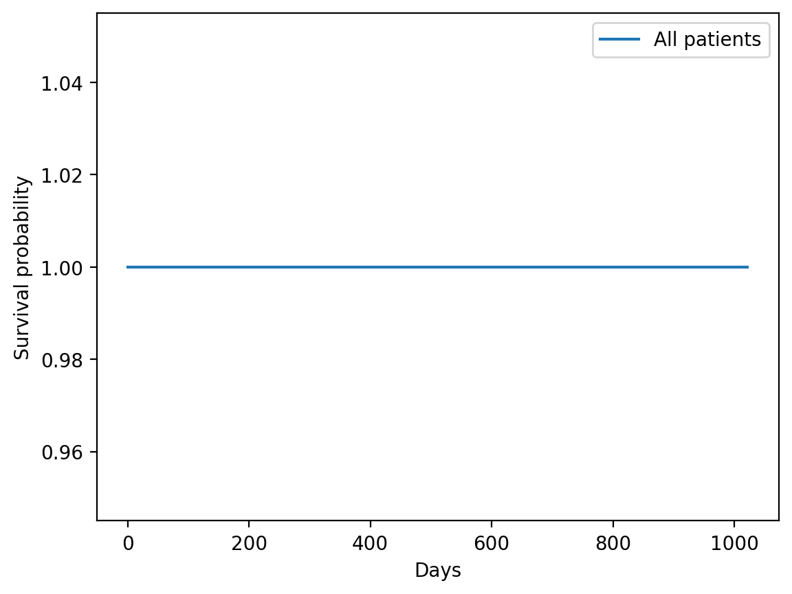

# survival-analysis-lung
Kaplan–Meier and Cox regression on the public NCCTG lung cancer dataset using lifelines
# Survival analysis of the NCCTG lung cancer dataset

A small, reproducible example of survival analysis with Python (lifelines):
Kaplan–Meier curves, log-rank test, Cox proportional hazards regression and
penalised Cox regression evaluated by concordance index.

## Data
Public NCCTG lung cancer dataset, bundled with the `lifelines` package.
[N] patients after removing rows with missing values; [N] deaths.
Patients who were alive at last follow-up are treated as censored.

## Methods
1. Kaplan–Meier survival curves (overall, and by sex) with a log-rank test.
2. Cox proportional hazards model; proportional hazards assumption checked.
3. Discrimination evaluated with the concordance index (C-index) on a
   30% held-out test set.
4. Ridge-penalised Cox regression compared using 5-fold cross-validation.

## Results
- Log-rank test (sex): p = [value]
- Cox model: [one sentence, e.g. which variables had hazard ratios whose
  confidence intervals did not include 1]
- Test C-index: [value]
- Cross-validated C-index for penalizer 0 / 0.01 / 0.1 / 1.0: [values]

## Limitations
- Complete-case analysis (rows with missing values removed).
- Small dataset; results are for learning, not clinical use.
- Calibration and uncertainty of predictions were not assessed.
- [Whether the proportional hazards check flagged any variable.]

## How to reproduce
    pip install -r requirements.txt
    python src/survival_analysis.py

## Author
Tamara Talakesh
