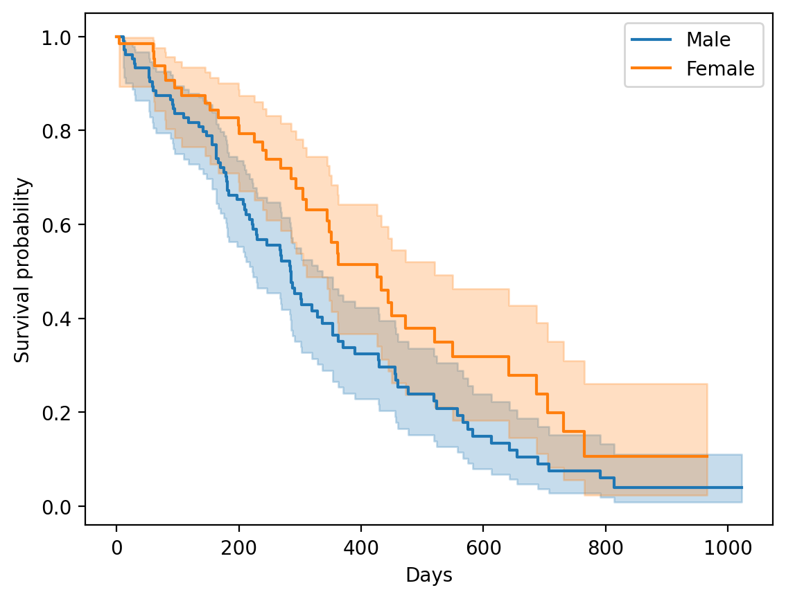
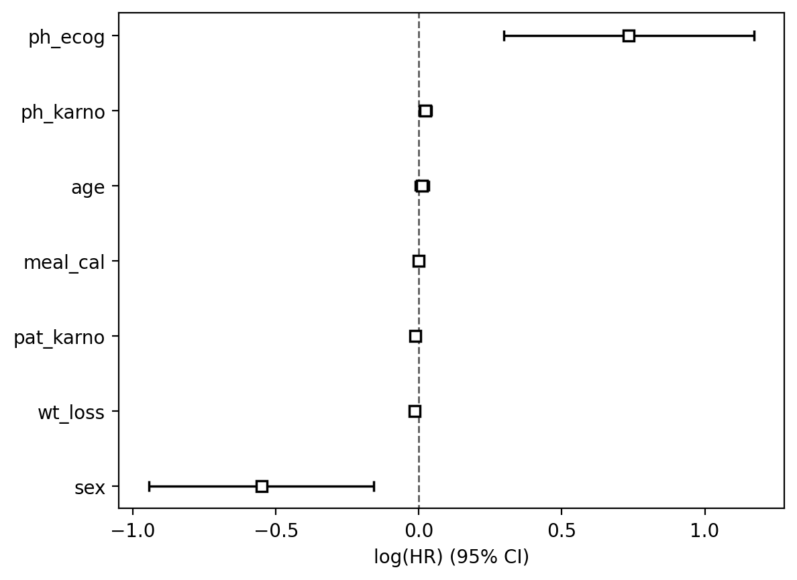

# Survival analysis of the NCCTG lung cancer dataset

A small, reproducible example of survival analysis in Python (lifelines):
Kaplan–Meier curves, log-rank test, Cox proportional hazards regression and
ridge-penalised Cox regression evaluated with the concordance index.

## Data
Public NCCTG lung cancer dataset, bundled with the `lifelines` package.
168 patients remained after removing rows with missing values (complete-case
analysis); 121 deaths. Patients who were alive at last follow-up are treated
as censored. In this version of the dataset, `status` is coded 0 = censored,
1 = death.

## Methods
1. Kaplan–Meier survival curves (overall, and by sex) with a log-rank test.
2. Cox proportional hazards model with age, sex, ECOG score, Karnofsky
   scores, calorie intake and weight loss. Proportional hazards assumption
   checked.
3. Discrimination evaluated with the concordance index (C-index) on a 30%
   held-out test set (random_state = 42).
4. Ridge-penalised Cox regression (penalizer 0, 0.01, 0.1, 1.0) compared with
   5-fold cross-validation.

## Results
- Log-rank test by sex: p = 0.013.
- Cox model: sex (HR 0.58, 95% CI 0.39–0.85) and ECOG performance score
  (HR 2.08, 95% CI 1.35–3.23) were associated with survival. Physician
  Karnofsky score was borderline (HR 1.02, 95% CI 1.00–1.05). Age, patient
  Karnofsky score, calorie intake and weight loss were not significant.
- Test-set C-index: 0.66.
- Cross-validated C-index: 0.579 (penalizer 0, 0.01 and 0.1) and 0.599
  (penalizer 1.0).

## Limitations
- Complete-case analysis: rows with missing values were removed.
- Small dataset (168 patients); this is a learning exercise, not clinical use.
- The test-set C-index (0.66) and cross-validated C-index (about 0.58–0.60)
  differ, showing that performance estimates from a small test set are
  unstable. No confidence intervals were computed for the C-index.
- The improvement with penalizer 1.0 is small and not tested for significance.
- The proportional hazards check flagged one variable (`meal_cal`, p = 0.03);
  this was not corrected. With seven covariates, one flag may occur by chance.
- The two Karnofsky scores (physician and patient) are likely correlated.
- Calibration and uncertainty of predictions were not assessed.

## How to reproduce
    pip install -r requirements.txt
    python src/survival_analysis.py

## Author
Tamara Talakesh
